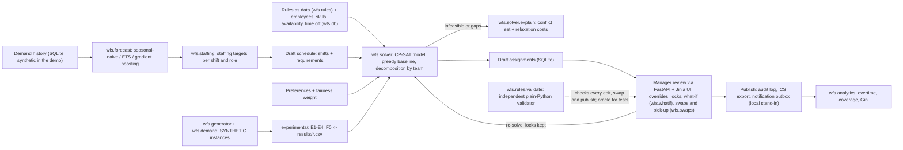

<p align="center"></p>

<p align="center">
  
  
  
</p>

# Workforce Scheduling & Shift Optimization Platform

> Build fair, compliant schedules that match staffing to demand, and cut overtime.

A scheduling platform for shift-based operations such as warehouses, contact centers, hospitals and retail chains. A constraint solver builds schedules that respect labor rules, skills and preferences, forecasts drive the staffing targets, and managers keep control through what-if scenarios and manual overrides.

**Quick links:** [Architecture](#architecture) · [Tech stack](#tech-stack) · [Engineering decisions](#engineering-decisions) · [Roadmap](#roadmap) · [Case study](docs/case-study.md) · [Research report](docs/research-report.md)

> **Public showcase.** This repository holds the documentation, client case study, research report and measured results for this product. The runnable source code is distributed separately under a license: see [SOURCE-ACCESS.md](SOURCE-ACCESS.md).

## At a glance

|  |  |
|---|---|
| **Track** | Business · Advanced |
| **Phase** | Beta: all five milestones are built and tested and all four experiments have recorded results. It runs locally on synthetic data only; it is not deployed, has no authentication and has never been used on a real workplace. |
| **Primary reader** | Clients and founders |
| **Read next** | [README](README.md) · [Client case study](docs/case-study.md) · [Research report](docs/research-report.md) |

## Why this exists

Managers build schedules by hand in spreadsheets, spend hours on every change, and still end up with unfair shift distribution, compliance mistakes, overtime spikes and gaps against actual demand.

## What it does (all of this is built and tested)

- **Data model and rule engine (M1).** Employees with skills, certifications, contracts, weekly availability, time off and shift preferences; sites, shift types and concrete shifts; SQLite persistence. Labor rules are *data* (`RuleSpec` rows per site): maximum hours per day and week, minimum rest, maximum consecutive days (including carry-over from the previous period) and per-shift-type weekly limits. Skill and certification coverage, availability, time off, no overlap and a contractual weekly ceiling are always enforced.
- **Schedule generation (M2).** CP-SAT model with coverage, labor cost with an overtime premium, shift preferences and a tunable fairness weight (absolute deviation of each employee's undesirable-shift burden from the median); a greedy baseline; a decomposition-by-team variant for large instances; **explainable infeasibility**: a minimal set of conflicting rules / availability / coverage requirements (from CP-SAT unsat cores) and, for each member, the mildest relaxation that restores coverage with its labor cost.
- **Manager review (M3).** Draft schedules, roster grid with coverage and violation highlighting, overrides that are checked against the same rules and rejected with reasons, locks that survive re-solves, an audit trail, publishing, open-shift tracking and iCalendar (`.ics`) export.
- **Forecasting and staffing targets (M4).** Seasonal-naive, ETS (Holt-Winters) and gradient-boosting forecasters over daily volume per shift slot, converted into staffing requirements per shift and role (plus a required first-aid-certified worker per shift) that feed the solver.
- **Swaps, what-if, analytics (M5).** Shift swaps, give-aways, releases and open-shift pick-up validated with the same rules (and rejected if they would lower coverage); what-if scenarios for absence, demand surge and a new rule, shown side by side as base / no action / re-optimised (optionally anchored to the current schedule to limit churn); analytics for overtime, coverage and the Gini coefficient of undesirable shifts.
- A seeded **synthetic instance generator** and a **benchmark harness** for experiments E1 to E4 (plus a forecasting backtest). Everything the demo shows is generated data and is labelled as such in the UI.

## Not built yet / out of scope

| Item | Why |
|---|---|
| Real email / SMS / push delivery | Needs paid provider accounts. Built as a **local stand-in**: `OutboxNotifier` writes messages to a database outbox (status `queued`, viewable at `/outbox`) and never sends anything. The `Notifier` interface is where a provider adapter would go. |
| Calendar *sync* | Only one-way `.ics` file export is built; no live sync with Google/Outlook calendars (needs OAuth apps). |
| Authentication, roles, multi-tenant isolation | Single-tenant local demo; the server binds to `127.0.0.1` and has no login. An employee self-service portal is therefore not built: swap and pick-up requests are made through the manager UI/API. |
| Hosted infrastructure (PostgreSQL, Redis job queue, Docker, Terraform, OpenTelemetry) | The blueprint's stack was a proposal. SQLite and an in-process solver call are used, so a long solve blocks one request thread. No container is provided (the Docker daemon was not available). |
| Real-world data and public benchmark instances | No client data exists; experiments use generated instances only. Public nurse-rostering benchmarks were not run (the instance format is different). |
| Multi-site schedules in one model | Sites exist in the data model; each schedule covers one site and employees belong to one site. |
| Sub-hour shift granularity, split-shift pay rules, per-jurisdiction rule packs | Shifts start and last whole hours; rule types listed above are all that is implemented. |
| "Last period's schedule repeated" baseline from the research protocol | Not implemented; see the change log in the research report. |
| Forecast horizon beyond 7 days from one fit | Longer horizons are forecast recursively (forecast fed back as history), which is unvalidated. |

## Architecture



## Tech stack

| Layer | Technology actually used |
|---|---|
| Language, tooling | Python 3.12, `uv` (lockfile `uv.lock`), ruff, mypy (strict), pytest, hypothesis |
| Optimization | OR-Tools CP-SAT; greedy constructive heuristic; decomposition by team |
| Forecasting | scikit-learn `GradientBoostingRegressor`, statsmodels Holt-Winters ETS, seasonal-naive baseline |
| API and UI | FastAPI, Jinja2 templates, a little vanilla JavaScript (no build step, no external assets) |
| Data | SQLite (stdlib `sqlite3`, no ORM) |
| Notifications | Local outbox table behind a `Notifier` interface (stand-in; nothing is sent) |
| Experiments | numpy, pandas, scipy (bootstrap CIs, Wilcoxon, Cliff's delta, Holm), psutil (CPU load) |
| CI | GitHub Actions workflow file `.github/workflows/ci.yml` (written to run the same commands as below; **never run**, because nothing was published) |

## Engineering decisions

### Rules are data, not code

Labor rules and local agreements are declarative constraints that can be configured, tested and versioned per site (`RuleSpec` rows in SQLite, edited via `PUT /api/sites/{id}/rules`). Each rule type has a plain-Python checker and a CP-SAT encoding; a schedule takes a snapshot of the rules at creation. Rule defaults are illustrative, not legal advice.

### One validator, many users

`wfs.rules.validate` is written independently of the solver encoding. It checks manager overrides, swaps and pick-ups, gates publishing, drives the greedy heuristic, and is the oracle in the property-based tests. A differential test fuzzes random rule parameters and arbitrary assignments and requires the validator and the CP-SAT model to agree. (It caught a real disagreement about carry-over from the previous period during development.)

### Fairness is an explicit objective

The solver balances undesirable shifts (night 2 points, weekends +1) by penalising each employee's absolute deviation from the median burden, and reports the Gini coefficient so managers can see and explain the trade-off. Fairness has a price in cost, coverage within a time limit and preferences; experiment E2 measures it.

### Explainable infeasibility

When a schedule cannot satisfy every rule, the platform says which rules conflict and what relaxing each would cost, instead of returning a failure. Conflict sets come from CP-SAT assumptions over a gated copy of the model and are shrunk to minimal sets; independent conflicts are reported separately.

### Honest limits of the optimiser

Time-limited CP-SAT runs on these models usually stop with a large reported optimality gap even when the solution found is good, because the cost lower bound is weak. Gaps, time limits and achieved objectives are therefore reported for every run instead of claiming optimality.

## Quality bar

- Property-based tests (hypothesis): no schedule produced by CP-SAT or by the greedy heuristic violates a hard rule on randomly generated instances and rule parameters; locked assignments survive re-solves; validator and solver model agree on arbitrary assignments.
- Regression tests for known-tricky rule combinations: rest after night shifts, two shifts on one day, midnight-crossing shifts against time off, certification coverage, carry-over of consecutive days and rest from the previous period.
- Stability: re-solving anchored to the current schedule never changes more assignments than a free re-solve in the tests, and what-if results report the number of changed assignments.
- Solver benchmarks with time limits, achieved objectives and optimality gaps recorded in `results/` (synthetic instances only).
- Test status when this README was written: see [Verification](#verification).

## Results at a glance (synthetic data; details and caveats in the [research report](docs/research-report.md))

All instances and demand are **synthetic**; each solve used at most 2 CP-SAT workers on a shared machine that was already close to 100% CPU load, with 20 to 60 s time limits (the protocol said five minutes). Raw rows are in `results/`; tables, intervals and caveats are in the report.

| Hypothesis | Verdict | Headline (median [95% CI]) |
|---|---|---|
| H1: CP-SAT cuts overtime cost by at least 10% versus greedy at 100 or more employees | Supported on this generator (at 60 s, not 5 min) | Overtime-cost reduction 100% [87%, 100%] over 20 paired instances; total labour cost only about 0.4% to 1.1% lower. At 1,000 employees no CP-SAT variant reached full coverage in 60 s while greedy did. |
| H2: a fairness objective cuts Gini by at least 30% for under 3% extra cost | Supported on the stated criteria, with side costs | Weights 100 to 300: Gini down about 55% to 60% for 1.1% to 1.8% more cost; but more disliked assignments, more overtime and more unfilled slots within the time limit. |
| H3: solve time grows super-linearly; decomposition by team keeps large instances in the time limit | Partly supported | Time to first solution slope 1.29 [1.16, 1.39] on log-log axes. Decomposition met the time budget (so did the single model, which simply stops), and gave better coverage than a cold single model only at 500 and 1,000 employees; greedy beat all CP-SAT variants at 1,000. |
| H4: 10% lower forecast error gives a measurable cut in understaffing | Measurable but small | 0.3 to 0.9 fewer understaffed requirement lines out of 62 (4% to 7%); Holm p 0.008 to 0.034. |

Forecasting backtest (synthetic series): ETS and gradient boosting were equally accurate (WAPE 0.083 vs 0.082) and about 29% better than seasonal-naive (0.117).

## Roadmap

- [x] M1: employees, skills, availability and the rule model (data model, SQLite persistence, declarative rules; tests in `tests/test_rules.py`, `tests/test_m1_data_model.py`, `tests/test_properties.py`)
- [x] M2: constraint-solver schedule generation for one site, plus greedy baseline, decomposition and explainable infeasibility (`tests/test_solver.py`, `tests/test_explain.py`, `tests/test_properties.py`)
- [x] M3: manager review, overrides and publishing, including `.ics` export (`tests/test_m3_review.py`, `tests/test_api.py`)
- [x] M4: demand forecasting and staffing targets (`tests/test_m4_forecast.py`; backtest F0 and experiment E4)
- [x] M5: swaps, what-if scenarios and analytics (`tests/test_m5_swaps_whatif.py`)
- [ ] Not on the roadmap yet: real notification providers, authentication, calendar sync, hosted deployment, real-data validation

## Getting started

> _These instructions refer to the source package, which is distributed separately and is not part of this showcase repository._

Requires [uv](https://docs.astral.sh/uv/) (it installs Python 3.12 itself). Windows 11 with bash and PowerShell was used. **Windows: install in a short path** (for example `C:\dev\wfs`). When the project sat in a folder deep enough that the OR-Tools folder inside `.venv` had a path of about 210 characters, importing OR-Tools failed with `ImportError: initialization failed`; the identical package passed from a path of about 120 characters. This is the only platform problem found. These are the exact commands that were run, starting from a clean checkout:

```bash
uv sync                                        # create .venv from uv.lock
uv run python -m wfs.seed --with-schedule      # optional: (re)create data/wfs.db with SYNTHETIC data and a first draft (deletes an existing file)
uv run python -m wfs                           # start the app on http://127.0.0.1:8000 (auto-seeds if data/wfs.db is missing)
```

Open http://127.0.0.1:8000, create a draft from a forecast, press **Generate**, click roster cells to override, then try **Explain gaps**, **What-if**, **Swaps & open shifts**, **Analytics**, **Publish** and the `.ics` download. Settings are optional environment variables, see `.env.example`.

```bash
uv run pytest                                  # tests (several minutes: they run real solves)
uv run ruff check .                            # lint
uv run ruff format --check .                   # formatting
uv run mypy                                    # strict type check

uv run python -m experiments.run_all           # every experiment, then results/summary.md (hours; at most 2 solver workers)
uv run python -m experiments.run_all --quick   # smoke test of the harness (minutes, writes to .tmp/results-quick)
uv run python -m experiments.e1                # or run one: e1, e2, e3, e4, f0 (add --resume to continue)
uv run python -m experiments.summarize         # rebuild results/summary.md from the raw CSVs
```

The CI workflow in `.github/workflows/ci.yml` runs `uv sync --locked`, ruff, mypy, pytest and the quick experiment run. **It has not been executed anywhere**; the local commands above are what was actually run.

## Verification

> _These instructions refer to the source package, which is distributed separately and is not part of this showcase repository._

Last verified from a clean environment (`.venv` deleted, then `uv sync --locked`):

- `uv run ruff check .` passed and `uv run ruff format --check .` reported 49 files already formatted.
- `uv run mypy` (strict) reported no issues in 46 source files.
- `uv run pytest`: **117 passed, 1 skipped** in 544 s (the skip is a conditional test that only applies when another certified worker is not already covering the shift). The suite includes hypothesis property tests (hard-rule safety of CP-SAT and greedy output, locked assignments, validator-versus-solver differential test), rule unit tests, solver tests, explainability tests, persistence, API/UI smoke tests, ICS parsing with the `icalendar` library, forecasting and staffing tests, swap / pick-up / what-if / analytics tests, and tests of the experiment harness.
- The full experiment run (`experiments.run_all`) was executed once (about 2.5 hours), followed by a second pass for the E3 greedy reference arm (`experiments.e3 --resume`); the `--quick` smoke run of each experiment was also executed.
- The web UI was exercised by hand in one browser (roster grid, cell override dialog with rule explanations, swaps page, what-if and analytics pages render); it has not been tested on other browsers or at scale, and the JavaScript has no automated tests.
- The GitHub Actions workflow has **not** been run.

## Repository layout

> _These instructions refer to the source package, which is distributed separately and is not part of this showcase repository._

```
wfs/            domain model, rules, solver/, forecast, staffing, service, swaps, whatif, analytics, api, web/
experiments/    E1-E4, F0 scripts, summarize.py, run_all.py
results/        raw per-run CSVs, *_meta.json (hardware, versions), summary.md/json (generated)
tests/          pytest + hypothesis
docs/           case study, research report, assets
```

## Skills demonstrated

`Constraint programming and optimization` · `Forecasting` · `Rules-engine design` · `Fairness metrics` · `Explainable systems` · `Operations-research-driven product design`

## One project, three lenses

The same project is documented for three audiences, so one body of work serves every goal.

| If you are… | Read | You will find |
|---|---|---|
| Hiring or reviewing engineers | [This README](README.md) | Architecture, trade-offs, quality bar and what I would defend in a design review |
| A client or founder | [Client case study](docs/case-study.md) | The business problem, the value levers, how it is measured and how an engagement runs |
| A researcher or technical reviewer | [Research report](docs/research-report.md) | Hypotheses, methods, statistical plan, results with confidence intervals and the reproducibility checklist |

## Author

Built by **[The Diamond Empire](https://thedempire.shop/)**.
