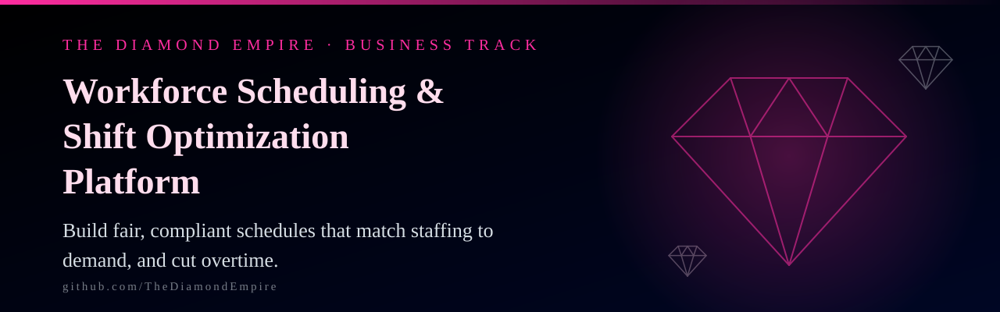

# Workforce Scheduling & Shift Optimization Platform: Client Case Study

> Less overtime, better coverage and schedules employees see as fair.

> **Status of this document.** This is a reference case study: it sets out the business problem, the solution and the value model. The results table is intentionally blank and is filled in only from measured data (a pilot or a real engagement). No outcome figures are claimed here. The platform behind it exists as a working prototype that runs locally on synthetic data; benchmark results on generated instances are in the [research report](research-report.md) and are not client outcomes.

## Snapshot

|  |  |
|---|---|
| **Who it is for** | Operations managers in warehouses, contact centers, hospitals and multi-site retail with fifty to several thousand shift workers. |
| **Solution** | Build fair, compliant schedules that match staffing to demand, and cut overtime. |
| **Track** | Business · Advanced |
| **Delivered by** | The Diamond Empire |

## The challenge

Schedule building eats days every period, last-minute changes cascade, overtime is the default fix, and employees feel the process is arbitrary, which drives turnover.

## The solution

A scheduling platform for shift-based operations such as warehouses, contact centers, hospitals and retail chains. A constraint solver builds schedules that respect labor rules, skills and preferences, forecasts drive the staffing targets, and managers keep control through what-if scenarios and manual overrides.

What the client gets in practice:

- Demand-driven staffing targets from historical volume forecasts (seasonal-naive, ETS and gradient-boosting models, backtested before use)
- A configurable rule engine: maximum hours per day and week, minimum rest, maximum consecutive days, per-shift-type limits, skill and certification coverage. Labor-law and union-agreement clauses are mapped onto these rule types during the Model phase; a clause that needs a new rule type is a small, tested code change
- Automatic schedule generation with a constraint solver, optimizing coverage, cost and overtime, preferences and a tunable fairness weight, with a greedy fallback
- Employee availability, time-off requests and shift preferences
- Shift swaps and open-shift pick-up with the same rules applied automatically
- Manager review with overrides and locks, what-if scenarios (absence, demand surge, new rule), publishing, calendar (.ics) export and an analytics view
- Plain-language explanations when full coverage is impossible: which rules conflict and what relaxing each would cost

## How it creates value

| Value lever | How the solution delivers it | How we measure it |
|---|---|---|
| Labor cost | Better matching of staffing to demand reduces overtime and idle hours | Overtime hours; labor cost per unit of volume |
| Coverage and service level | Staffing follows forecasted demand and skills | Understaffed intervals; service-level attainment |
| Manager time | Automatic generation and what-if tools replace manual building | Hours per scheduling cycle |
| Compliance | Rules are enforced automatically | Rule violations; audit findings |
| Retention | Fairer shifts and preference handling improve satisfaction | Voluntary turnover; swap-request rates |

## How an engagement runs

| Phase | What happens |
|---|---|
| Model | Rules, skills and demand patterns |
| Backtest | Replay past periods and compare with actual schedules |
| Pilot | One site for two scheduling cycles |
| Expand | Remaining sites with local rule variants |

## What the client receives

- Configured platform with the client’s rules and sites
- Demand forecasts backtested on the client’s history
- Solver tuning for the client’s instance sizes
- Integration of the client’s notification channels (the prototype queues messages in a local outbox; email, SMS and push providers are connected during an engagement) and authentication, which the prototype does not have
- Employee onboarding and manager training
- Schedule-quality reporting built on the platform's analytics (overtime, coverage, fairness); a monthly report is an engagement deliverable, not a built feature

## Results

Baseline measurements are taken **before** the solution goes live, and the same measures are taken after, so every change in the table is attributable and honest.

| Measure | How measured | Baseline | After | Change |
|---|---|---|---|---|
| Labor cost | Overtime hours; labor cost per unit of volume | — | — | — |
| Coverage and service level | Understaffed intervals; service-level attainment | — | — | — |
| Manager time | Hours per scheduling cycle | — | — | — |
| Compliance | Rule violations; audit findings | — | — | — |
| Retention | Voluntary turnover; swap-request rates | — | — | — |

> **To fill in:** replace each — with measured values and add the measurement window and sample size beneath the table.

## How quality and risk are managed

- Property-based tests: no generated schedule violates a hard rule, checked against an independent plain-Python validator
- Solver benchmarks with fixed time limits, achieved objectives and optimality gaps recorded (on synthetic instances; they are re-run on the client's instances during the Backtest phase)
- Regression tests of known-tricky rule combinations (rest after night shifts, two shifts in one day, midnight-crossing shifts against time off, certification coverage, carry-over from the previous period)
- Stability: re-planning after a change can be anchored to the current schedule, and what-if results report how many assignments changed

## Is this a fit?

Best suited to: operations managers in warehouses, contact centers, hospitals and multi-site retail with fifty to several thousand shift workers.

## Talk to me

Want this adapted to your business? Get in touch via **[thedempire.shop](https://thedempire.shop/)**.

---

[README](../README.md) · [Client case study](case-study.md) · [Research report](research-report.md)
